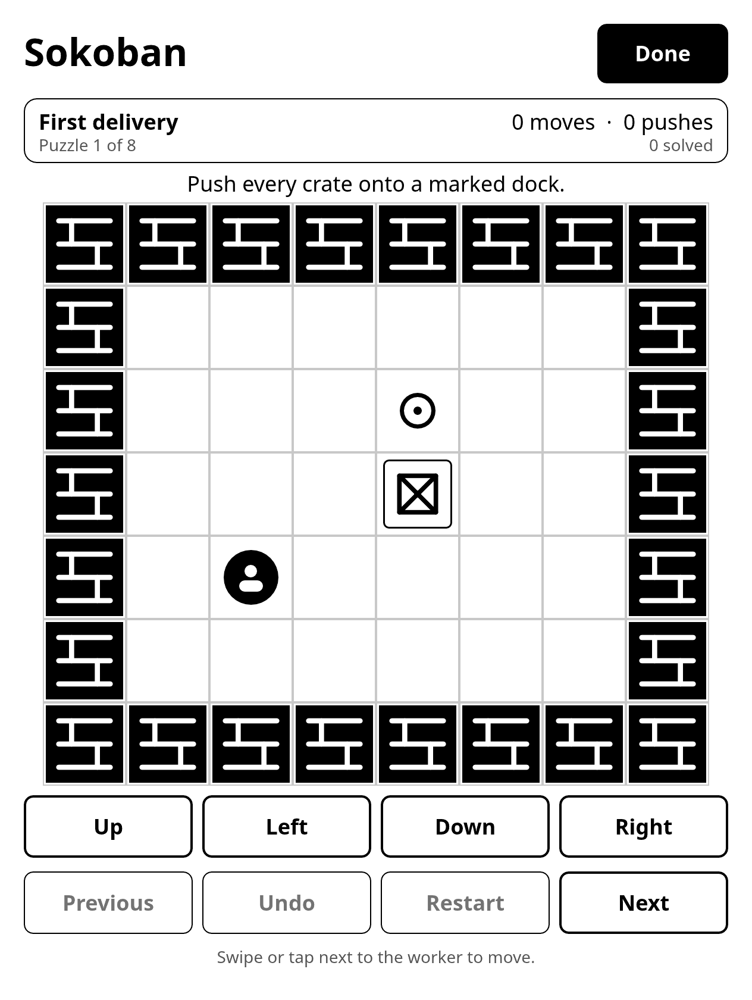
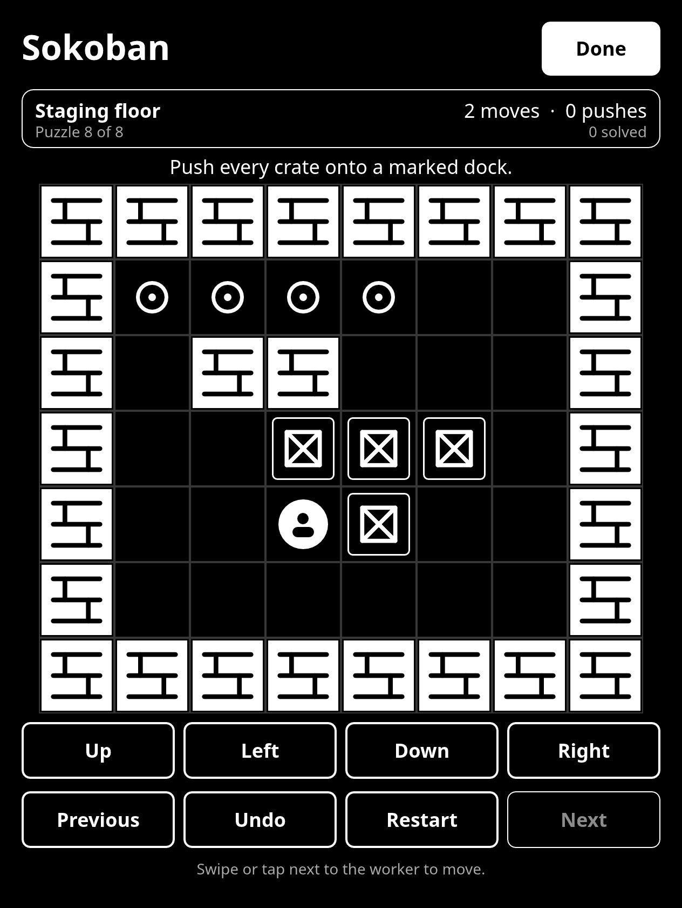

# Sokoban

Sokoban is an offline warehouse puzzle for PrimitiveOS. Move the worker through eight original layouts and push every crate onto a marked dock.

| First delivery | Staging floor in dark mode |
| --- | --- |
|  |  |

## How to play

- Swipe across the board, tap a square next to the worker, or use the direction buttons to move one square.
- Walk into a crate to push it. The square behind it must be free.
- Use **Undo** to take back a move, including after you solve a puzzle.
- Use **Previous** and **Next** to choose a puzzle. The game saves your position and undo history for every layout.

## Install and preview

Open **Store** from Primitive Launcher and search for **Sokoban**. See the [installation guide](INSTALL.md) for package details.

Keep the shared Tools and Launcher repositories alongside this app to render the preview locally.

```sh
cargo test --workspace --locked
cargo run --locked -p crateshift-desktop -- build/previews
```

## License

The code uses the [PolyForm Noncommercial 1.0.0 license](LICENSE). Documentation, artwork, and screenshots use the [CC BY-NC-SA 4.0 license](LICENSE-DOCS).
